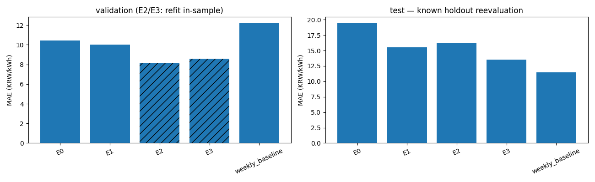
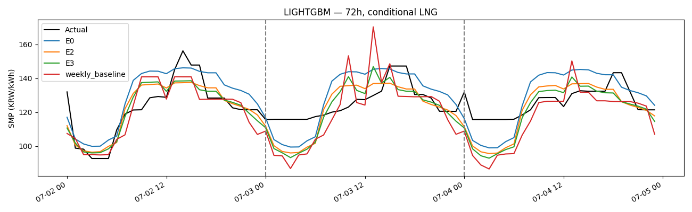

# LIGHTGBM 72시간 예측 업그레이드

발전량 보완 전 공통 v3 입력을 그대로 사용한 실제 실행 결과입니다. XGBoost·LightGBM만 추가 업그레이드했으며, 원본 모델·데이터·보고서와 완료된 LSTM·SARIMAX 업그레이드는 변경하지 않았습니다.

데이터 버전: `v3_a90141b81ecd_lag72`

## 사전에 확정한 최종 방식

최종 예측 = 0.7 × 재학습 모델 + 0.3 × 주간 기준선

채택 실험은 **E3**입니다. 혼합 가중치는 Validation으로 선택했고 하반기 결과를 보고 다시 고르지 않았습니다. 편향 보정은 `none`입니다. none이면 보정을 적용하지 않아 E4는 E3와 같습니다.

## 하반기 재평가

|실험|MAE 원/kWh|RMSE 원/kWh|R²|평균 편향|
|---|---:|---:|---:|---:|
|E0|19.4655|23.3385|-0.0238|17.3198|
|E1|15.5377|19.2254|0.3053|12.5043|
|E2|16.2328|20.2047|0.2327|12.7679|
|E3|13.5582|17.2984|0.4376|9.3179|
|E4|13.5582|17.2984|0.4376|9.3179|
|daily_baseline|13.0875|19.7381|0.2677|1.1096|
|weekly_baseline|11.4334|17.7715|0.4064|1.2681|

기존 MAE 19.4655 → 채택 결과 13.5582원/kWh입니다. 오차 감소율은 기존 모델 대비 30.35%, 주간 기준선(11.4334) 대비 -18.58%입니다. **채택 결과는 모델 단독이 아니라 재학습 모델과 기준선의 혼합 성능입니다.**

E0는 기존 모델, E1은 기존 모델과 기준선 혼합, E2는 Train+Validation 재학습 단독, E3는 재학습과 고정 가중치 혼합, E4는 검증에서 선택한 편향 보정입니다. daily/weekly_baseline은 기준선 단독입니다. α가 0으로 선택될 경우 기준선만 사용하는 결과로 표시해야 합니다.

## 1. 기준선 혼합 검증

기존 Validation 예측에서 일별·주간 기준선과 α=0.0~1.0(0.1 간격)을 비교했습니다. 모든 72시간에 같은 가중치를 적용했습니다. 모든 후보의 값은 outputs/metrics/blend_validation_grid.csv에 있습니다. 기준선이 참조하는 SMP의 시간 구간이 origin−72시간 이전에 완결되는지도 확인했습니다.

## 2. 순차 검증과 편향 보정

최종 재학습 전에 1~2월, 3~4월, 5~6월을 순서대로 예측했습니다. 각 구간 이전의 정답만 계수·가중치 적합에 사용했으며, 경계를 넘는 72시간 블록은 제외했습니다.

1~4월 OOF에서 전체·D+1/D+2/D+3별 평균 편향을 계산하고 5~6월에서 보정 효과를 비교했습니다. MAE가 1% 이상 개선되고 5월·6월 모두 악화되지 않아야 채택하도록 미리 정했습니다. 채택되지 않은 보정을 하반기 실제값으로 다시 계산하지 않았습니다.

OOF는 12,600행입니다. 두 내부 경계의 블록을 제외해 전체 Validation 12,888행보다 288행 적습니다. 이는 실패하거나 어려운 예측을 골라 뺀 것이 아닙니다. 하반기 평가 행은 모든 실험에서 13,104행으로 같습니다.

원래 모델 설정·반복 수와 혼합 가중치 선택에 이미 Validation을 사용했으므로, 이 OOF를 완전한 중첩 검증 또는 새 독립 시험이라고 해석하지 않습니다. 고정 설정의 시간순 안정성과 편향 보정을 점검한 보조 검증입니다.

## 3. Train+Validation 재학습

고정 설정: `{'params': {'n_estimators': 1200, 'learning_rate': 0.03, 'num_leaves': 15, 'max_depth': 5, 'min_child_samples': 100, 'subsample': 0.85, 'subsample_freq': 1, 'colsample_bytree': 0.85, 'reg_lambda': 10, 'reg_alpha': 0.1}, 'best_rounds': 187, 'validation_mae': 10.428670578738119}`.

원래 트리 설정을 유지하고, 기존 Validation에서 선택된 best_rounds를 n_estimators로 고정해 2023년~2025년 상반기를 학습했습니다. XGBoost는 231회, LightGBM은 187회입니다. 조기 종료를 포함한 1,200회 상한을 다시 탐색하지 않고 정해진 횟수만 학습했으며, 최종 적합에는 평가 세트를 넣지 않았습니다.

공통 결측 대체 통계는 기존 Train 기준을 유지했습니다. 트리 모델에는 추가 표준화를 하지 않았습니다. Test로 통계나 모델을 적합하지 않았습니다.

**E2~E4의 Validation 값은 재학습에 포함된 표본의 학습내 오차입니다. 일반화 성능이나 설정 선택의 근거로 사용하지 않습니다.** 비교 그래프에도 이를 표시했습니다.

## 4. 오차·편향 분석

D+1~D+3, horizon 1~72, 월별 MAE·RMSE·R², 평균 편향, 과대·과소예측 비율, 실제값과 예측값의 분산을 outputs/metrics에 저장했습니다. 평균 편향이 양수이면 과대예측, 음수이면 과소예측입니다.

급등·급락은 Train 시간별 SMP 차분의 5/95백분위로 정의했습니다. 급락 기준은 시간 변화≤-20.3780, 급등 기준은 ≥22.3770원/kWh입니다. Test 정답은 이 구간의 사후 오차 분석에만 사용했습니다. 기간별 가격 분포와 입력 결측 비율도 함께 보존했습니다.

D+1/D+2/D+3별 별도 모델은 추가하지 않았습니다. 이번에는 고정된 구조의 시간순 검증과 편향 보정 비교까지만 수행했습니다.

## 유지한 연구 조건과 한계

- 매일 23시 발행, 다음 3일 총 72시간. 모든 목표시간에 공통 observed_cutoff=origin−72시간을 적용했습니다.
- 개별 실측 공개시각을 검증한 것이 아니라 72시간 지연을 가정했습니다. 과거 SMP도 같은 보수적 지연을 적용했습니다.
- 국내 LNG는 동월 단가 제공 조건부 실험입니다. FRED D−2 vintage, 중기예보 발표시각, 과거 수요예측 이력 규칙을 바꾸지 않았습니다.
- 2025년 발전량 99.726% 결측 대체 등 기존 v3의 입력 한계도 그대로입니다. 지역 범위·공표시각 재조사와 새 API 수집은 하지 않았습니다.
- 하반기는 이미 기존 성능을 확인한 기간이므로 이번 결과는 후속 재평가입니다. 새 블라인드 시험이나 독립 미래 성능으로 주장하지 않습니다.
- Train+Validation 전체 정답을 쓰는 오프라인 분할 실험입니다. 첫 Test 발행 시점에 학습 정답이 실제로 모두 공개됐는지까지 검증한 운영 시험은 아닙니다.

## 파일과 재현

```sh
python scripts/run_upgrade.py --source-project /path/to/1120gradpj
python scripts/evaluate_upgrade.py --model lightgbm --source-project /path/to/1120gradpj
```

코드·모델·설정·예측·그래프·보고서는 이 업그레이드 폴더에만 저장했습니다. 기존 공통 자료는 복사하지 않고 읽기 전용으로 참조합니다. LightGBM 실행기는 XGBoost 업그레이드 프로토콜을 재사용하고, 기준선·편향 선택 함수는 기존 LSTM 업그레이드의 공통 함수를 읽기 전용으로 재사용합니다. 재현 시 같은 브랜치의 해당 공통 스크립트도 필요합니다.

전체 예측은 outputs/predictions/*.csv.gz로 손실 없이 압축했습니다. 새 체크포인트는 models/에 있습니다. 원본 파일의 해시 불변과 저장 모델 재로딩 예측 일치를 검사했습니다. 선택일 HTML은 Plotly CDN 연결이 필요합니다.

Git 브랜치: `codex/xgboost-lightgbm-72h-upgrade-20261119`. 원격 커밋과 PR 링크는 GitHub에서 확인할 수 있습니다.




## 추가 검증

선택·경계 처리 검사 4개와 저장 결과·원본 보호 검사 4개, 총 8개가 통과했습니다. 원래 Train으로 다시 적합한 첫 순차 구간의 예측은 기존 모델과 최대 0.000000000원/kWh 차이로 일치했고, 체크포인트의 트리 수 187개도 확인했습니다. 원본 및 다른 모델의 현재 선택 파일은 변경되지 않았습니다.

업그레이드 검사는 선택 규칙 4개와 저장 결과·원본 보호 4개, 총 8개가 통과했습니다. 완료된 LSTM·SARIMAX 혼합 결과와도 하반기 13,104개 평가 키·정답이 일치함을 확인했습니다.
