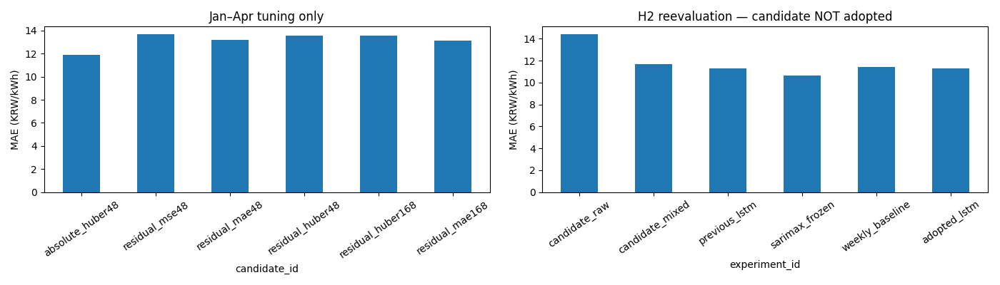
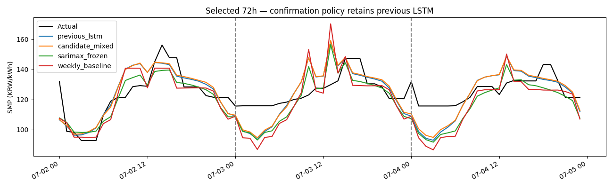

# LSTM의 사전 규칙 기반 개선 실험

**이번 후보는 확인 구간의 채택 기준을 통과하지 못했습니다. 기존 LSTM 업그레이드를 유지합니다.** 실패한 결과를 숨기거나 하반기에서 유리한 후보로 교체하지 않았습니다.

## 사전에 정한 절차

- 발전량 보완 전 공통 v3, 동일 12개 입력 그룹·72시간 지연·기존 결측 처리·SMP 목표와 평가 행을 유지했습니다. 새 API나 외부 입력은 추가하지 않았습니다.
- 후보 6개와 seed42를 학습 전에 고정했습니다. 가격 직접 예측과 주간 기준선 대비 잔차 학습, MSE·MAE·SmoothL1(β=1), 48/168시간 이력을 비교했습니다. 모든 후보에 공통 입력을 제공했습니다.
- 2023~2024년 Train으로 학습하고, 2025년 1~4월만으로 epoch·후보·주간 혼합 가중치를 선택했습니다.
- 선택한 한 후보만 Train+1~4월로 재학습한 뒤, 5~6월에서 확인했습니다. 나머지 후보를 확인 구간에 재차 대입하지 않았습니다.
- 5~6월 MAE가 이전 LSTM의 같은 기간 순차 예측보다 1% 이상 낮고, 5·6월 각각 악화되지 않아야 채택하도록 정했습니다.
- 확인 후 정책을 저장하고 Train+Validation으로 고정 epoch 재학습한 후보를 하반기에서 한 번 평가했습니다. 후보가 실패했으므로 최종 선택은 이전 모델로 유지했습니다.

## 1~4월 후보 전체 결과

|후보|목표|손실|이력|epoch|단독 MAE|혼합 MAE|모델 비중|
|---|---|---|---:|---:|---:|---:|
|absolute_huber48|absolute|huber|48|22|13.7160|11.8850|0.5|
|residual_mse48|weekly_residual|mse|48|1|14.0593|13.6491|0.1|
|residual_mae48|weekly_residual|mae|48|14|13.2294|13.1910|0.8|
|residual_huber48|weekly_residual|huber|48|3|13.7359|13.5529|0.4|
|residual_huber168|weekly_residual|huber|168|3|13.7366|13.5531|0.4|
|residual_mae168|weekly_residual|mae|168|15|13.1105|13.0950|0.9|

선택 후보: `absolute_huber48`, epoch=22, 모델 비중=0.5. 원래 6개 후보 모두의 설정·학습 곡선·체크포인트·튜닝 예측을 보존했습니다.

## 5~6월 확인 결과

|구간|후보 혼합 MAE|기존 LSTM 순차 예측 MAE|
|---|---:|---:|
|5~6월 전체|8.9645|8.8849|
|5월|8.3010|8.6329|
|6월|9.6508|9.1456|

후보는 전체 MAE가 더 높았고 6월에도 악화됐습니다. 사전 채택 규칙에 따라 기각했습니다. 이 결정은 하반기 점수를 계산하기 전에 final_policy_before_test.json에 기록했습니다.

## 하반기 후속 재평가

|결과|MAE 원/kWh|RMSE 원/kWh|R²|
|---|---:|---:|---:|
|candidate_raw|14.3774|18.5606|0.3525|
|candidate_mixed|11.6692|15.8568|0.5274|
|previous_lstm|11.2630|15.4813|0.5495|
|sarimax_frozen|10.6648|15.1910|0.5662|
|weekly_baseline|11.4334|17.7715|0.4064|
|adopted_lstm|11.2630|15.4813|0.5495|

candidate_raw는 새 LSTM 단독 출력이고 candidate_mixed는 고정 주간 혼합입니다. previous_lstm과 sarimax_frozen은 기존 혼합 결과를 읽기만 한 것입니다. adopted_lstm은 확인 구간에서 확정한 정책에 따른 선택 결과입니다. 하반기에서 가장 좋아 보이는 결과를 사후 선택한 것이 아닙니다.

## 해석과 한계

이번 6개 후보 안에서는 검증상 개선을 확인하지 못했습니다. 이것이 LSTM의 개선 가능성이 없다는 뜻은 아닙니다. 현재 자료와 규칙에서 새 후보를 채택할 근거가 부족하다는 뜻입니다. 입력별 결측·정보 지연, 가격 분포 변화 등의 제한도 그대로 남아 있습니다.

주간 잔차 모델은 전주 같은 시간 가격에 LSTM이 예측한 변화량을 더하는 구조입니다. 이는 기존에 이용 가능했던 과거 SMP 기준선을 활용하는 구조 변경이며, 순수 LSTM 성능으로 포장하지 않습니다. α=0이면 LSTM이 기여하지 않는 기준선 단독 결과로 표시해야 합니다.

하반기는 이미 여러 실험에서 확인한 기간입니다. 이번에도 새 독립 블라인드 시험으로 주장할 수 없습니다. 5~6월 또한 이전 실험에서 사용됐던 기간이지만 이번 후보 선택에는 쓰지 않고 확인에만 썼습니다. 확인 비교용 이전 LSTM의 설정은 원래 상반기 전체에서 정해졌다는 한계가 있습니다. 독립 성능 검증에는 새로운 미사용 기간이 필요합니다.

동월 LNG 제공 조건부 입력·실측72시간 지연 가정·2025년 발전량99.726% 결측 대체·서울108 관측소·시장/육지 범위 차이 등 기존 v3의 한계는 유지합니다. 지역/공표시각 재조사나 새 수집은 하지 않았습니다. 표준화는 각 적합 구간만으로 맞추고 공통 대체값은 기존 Train 통계를 재사용했습니다.

## 재현·검증

```sh
python scripts/run_experiment.py --source-project /path/to/1120gradpj --output-dir /tmp/new-lstm-experiment
python scripts/report_experiment.py --source-project /path/to/1120gradpj --experiment-dir /tmp/new-lstm-experiment
```

기존 결과는 덮어쓰지 않습니다. 재현에는 기존 공통 v3와 같은 브랜치의 원래 LSTM·SARIMAX 업그레이드 파일이 필요합니다. 새 실험은 LSTM 폴더 안에만 저장했습니다. 다른 세 모델과 기존 LSTM은 수정하지 않았습니다. 체크포인트 재로딩 예측 일치, 미래 정답 변경에 대한 입력 불변 및 보호 파일 해시를 확인했습니다.

[SmoothL1 공식 문서](https://docs.pytorch.org/docs/stable/generated/torch.nn.SmoothL1Loss.html) / [검증 분리 원칙](https://scikit-learn.org/stable/modules/cross_validation.html).




## 자동 검증

설계·체크포인트 검사 4개와 저장 결과·채택 규칙·원본 보호 검사 4개, 총 8개가 통과했습니다. 후보 6개의 튜닝 체크포인트를 다시 불러와 기록한 오차가 재현되는지도 확인했습니다. 다른 모델 및 기존 LSTM의 선택 파일·체크포인트·자료는 바꾸지 않았습니다.

Git 브랜치: `codex/lstm-legitimate-improvement-20261119`.

코드·최초 실험 산출물 커밋: `17791ac`. 원격 저장소: `gemmanzu-a11y/smp-graduation-2026`. 기존 LSTM·SARIMAX 업그레이드 브랜치를 기반으로 한 별도 미채택 실험 기록입니다.
