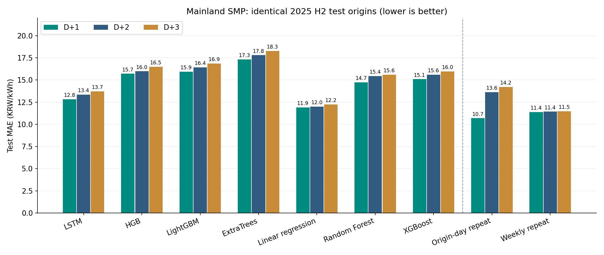

# 1120gradpj 실행 결과

작성: 2026-11-14T10:58:30.267668+09:00

새 프로젝트 생성, 공식 데이터 수집, 7개 모델의 실제 학습·저장·후향 평가를 수행했습니다. 최신 입력에 필요한 2026년 태양광·풍력 이력이 없으므로 현재 날짜의 다변량 예측은 차단합니다. 모든 요청 변수가 공개 시점까지 검증된 운영 모델을 완성한 상태는 아닙니다.

## 동일 조건의 모델 비교

23:00 KST 기준 D+1·D+2·D+3 각각 24시간. 학습 2023~2024, 검증 2025 상반기, 테스트 2025 하반기. MAE 단위는 원/kWh이며 낮을수록 좋습니다. 7개 모델과 두 기준선은 동일한 검증·테스트 origin을 사용했습니다.

| 모델 | D+1 MAE | D+2 MAE | D+3 MAE | 검증 전체 MAE | 테스트 전체 R² |
|---|---:|---:|---:|---:|---:|
| lstm | 12.834 | 13.362 | 13.724 | 9.694 | 0.478 |
| hgb | 15.709 | 15.988 | 16.503 | 9.723 | 0.268 |
| lightgbm | 15.938 | 16.428 | 16.866 | 9.906 | 0.227 |
| extra_trees | 17.336 | 17.805 | 18.278 | 10.166 | 0.127 |
| linear_regression | 11.909 | 12.001 | 12.239 | 11.827 | 0.518 |
| random_forest | 14.744 | 15.447 | 15.595 | 9.612 | 0.316 |
| xgboost | 15.093 | 15.594 | 15.974 | 9.700 | 0.300 |
| last_origin_day | 10.693 | 13.632 | 14.214 | 14.314 | 0.273 |
| weekly | 11.392 | 11.436 | 11.472 | 12.221 | 0.406 |

검증 MAE로 선택된 모델은 **random_forest**입니다. 이것이 테스트 최저 모델이라는 뜻은 아닙니다. 테스트에서는 7개 학습 모델 중 선형회귀가 가장 낮은 MAE였고, D+1은 origin 당일 반복 기준선, D+2·D+3은 전주 반복 기준선이 학습 모델보다 좋았습니다. 따라서 고도화한 모델이 단순 기준선을 일관되게 이겼다고 결론 내리지 않습니다.

검증과 테스트의 순위가 달라졌습니다. 정답 가격의 평균은 학습 142.93, 검증 117.54, 테스트 104.24원/kWh로 기간별 분포 차이가 있습니다. 이것만으로 성능 차이의 인과 원인을 확정하지 않습니다. 이후 개선은 별도 새 기간을 남겨 검증해야 하며, 이번 테스트에 맞춰 설정을 재선택하지 않았습니다.



## 실제 수행 규모

- 1,081개 origin, 77,832개 시간별 타깃.
- 학습 720개 origin / 51,840행, 검증 179개 / 12,888행, 테스트 182개 / 13,104행.
- 목표 날짜가 분할 경계를 넘는 origin 제외. 각 horizon마다 테스트 4,368행이며 같은 origin에서 목표 날짜가 1·2·3일씩 달라집니다.
- 48시간×8개 변수 + 목표 달력·가격 시차·결측 비율·공개시각으로 제한한 LNG 슬롯 = 406개 공통 특성. LNG 두 슬롯은 역사적 공개일이 없어 실제 사용되지 않았습니다.
- 총 학습·아티팩트 생성 시간 약 7.3분 (macOS CPU, 모델당 최대 4스레드, 데이터 수집 시간 제외).
- 10개 파이프라인 검사 통과. 모델별 독립 프로세스에서 저장 가중치의 72시간 재로드 예측 일치 확인. 원본 예측 CSV에서 지표를 재계산해 대조 통과. 최신 입력 부족 차단과 과거 명시 시점 추론도 실제 실행 확인.
- 모든 모델의 입력 fingerprint: `88fb0712634662d9e962bf9b3548082f1a7280dc43396dd200d24bef399e34aa`.

## 확보한 원천과 남은 조건

| 항목 | 이번 확보 결과 | 남은 한계 |
|---|---|---|
| 육지 SMP | 33,912시간, 2023-01-01~2026-11-13 | 과거 최초 공개·정정본 시각 미검증 |
| 수요·공급예비율 | 5분값 → 33,697시간 인덱스, 완전한 12개 표본이 있는 유효 시간 32,406개 | 4개 일자 원본 부재 및 부분 누락. 육지 단독 집계인지 별도 확인되지 않음 |
| 태양광·풍력 | 26,304시간 인덱스, 2023~2025, 제주 제외 | 시장참여 발전량 범위. 태양광 한 시간 결측. 2026년 과거 정산 이력 미확보 |
| 기상 | 6개 육지 ASOS 관측소 203,316건 | 단순 관측소 평균. 야간 일사 미측정을 실제 0이라고 바꾸지 않음 |
| LNG | 2023-01~2026-10, 46개월 원/kWh | 개별 월 공개일/증빙 미확보 → 후향 모델에서 제외 |
| 공휴일 | 2023~2027 한국 공휴일 표 | 인증 특일 API 403, python-holidays 대체 출처 명시 |

SMP/지역별 태양광/최신 발전 현황 인증 API는 성공했습니다. 과거 발전원별 발전량과 공휴일 API는 403이었습니다. 과거 자료는 공식 EPSIS 공개 요청과 공공데이터포털 CSV 다운로드로 보완했습니다. 두 키는 실행 메모리에만 전달했고 프로젝트 파일에 들어 있지 않은지 정확한 값으로 검사했습니다.

`first_received_at`은 이번 실제 수신 시각입니다. 이를 과거 최초 공개일로 쓰지 않았습니다. LNG 공개일은 근거가 없어 빈값으로 남겼습니다. 다른 실측에는 24시간, 재생발전에는 48시간 지연을 두었지만 이것은 연구 가정이며 당시 자료가 실제 공개되었다는 인증이 아닙니다.

## 추론 검수에서 수정한 문제

최신 2026년 입력에서는 태양광·풍력의 과거 48시간이 전부 비어 있습니다. LSTM에서 이 입력 누락이 학습 당시와 다른 분포를 만들어 비정상적으로 큰 출력이 나타났습니다. 값을 임의로 자르지 않고 공통 입력 검사로 모든 모델의 최신 추론을 차단했습니다. 초기 최신 CSV는 삭제했습니다.

현재 각 모델의 `latest_forecast_status.json`은 `blocked_missing_input`입니다. `reference_forecast.csv`는 2025-12-28 23시 참조 → 2025-12-29~31의 실제 72시간 테스트 재생입니다. 현재 날짜의 예측으로 표시하지 않습니다. `predict.py --model … --origin 2025-12-28T23:00:00+09:00`으로 저장 모델의 과거 72개 출력을 다시 생성할 수 있습니다.

동일 프로세스에 PyTorch와 LightGBM을 함께 로드하는 검수에서 네이티브 라이브러리 충돌이 발생해, 저장 모델 재로드도 모델별 독립 프로세스로 변경했습니다. 원래 학습 역시 모델별 독립 프로세스이며, 이 충돌로 모델을 대체하거나 실행 성공을 꾸미지 않았습니다.

SMP는 하루전 가격이므로 실제 23시에는 D+1 공식 가격이 이미 공개되어 있을 수 있습니다. D+1은 가려진 과거 가격 연구 비교와 실제 서비스에서 이미 알고 있는 공식 가격을 구분해야 합니다. 실제 운영 발급·일일 OS 예약·최신 데이터 완전성이 검증된 상태라고 주장하지 않습니다.

## 재실행·결과 파일

프로젝트 루트에서:

```sh
source .venv/bin/activate
python scripts/collect_data.py --prompt-keys
python scripts/build_dataset.py
python scripts/run_all.py
python -m unittest discover -s tests -v
python scripts/check_artifacts.py
python scripts/audit_readiness.py --strict
```

마지막 명령은 전체 요청 조건이 미충족이므로 현재 종료 코드 2가 정상입니다. 모델 학습 성공과 최신 운영 입력의 적격성을 분리합니다.

- `models/<모델>/algorithm.py`, `train.py`: 개별 알고리즘·실행 진입점.
- `models/<모델>/artifacts/`: 가중치, 전처리기, 전체 검증/테스트 예측, 72시간 과거 재생, 최신 차단 사유, 성능 CSV, 그래프.
- `model_comparison.csv`: 모든 모델·기준선·분할·horizon의 MAE/RMSE/R².
- `validation_selection.json`: 검증에 의한 선택 기록.
- `data_quality.json`, `collection_status.json`, `api_probes.json`, `readiness.json`: 확보/권한/결측/운영 가능 범위.
- `artifact_verification.json`: 동일 코호트·저장 모델 재로드·지표 재계산 확인.
- `SOURCES.md`: 공식 출처와 단위/수집 경로.

자동 하이퍼파라미터 탐색이나 2025 테스트를 포함한 운영 재학습은 하지 않았습니다. 별도 독립 가상환경 신규 설치와 Windows 실행은 미검증입니다.
